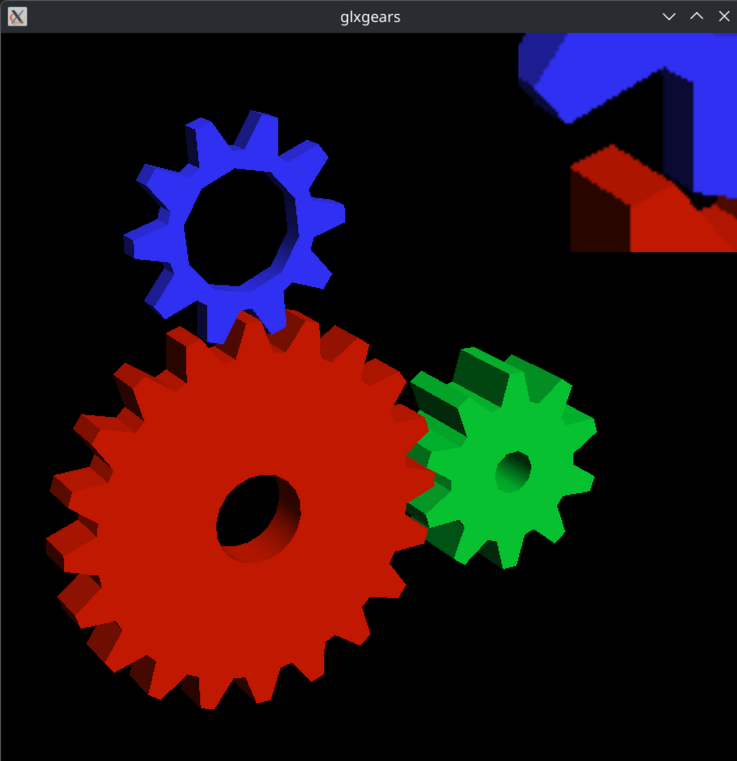

# OpenGL Inject

A Linux/GLX proof of concept that intercepts `glXSwapBuffers` using `LD_PRELOAD`,
captures the current framebuffer, and draws a shader-based magnified inset without
modifying the host application. Tested with Mesa `glxgears`; **not a general-purpose
overlay library**.

This small, experimental project explores Linux shared-library interposition,
`dlsym`, framebuffer/texture handling, shader integration, and host-state preservation.
The interception and injected inset are this project's work; the gears scene is not.



*Mesa `glxgears` running with this library's injected magnified framebuffer inset
(screenshot from the original experiment). `glxgears` is an external demo, not
implemented or bundled here.*

## What is intercepted / how it works

```text
host application
    -> glXSwapBuffers interception (LD_PRELOAD)
    -> capture GL_BACK from the default read framebuffer
    -> update a reusable texture
    -> draw a magnified fragment-shader inset
    -> restore modified host GL state
    -> real glXSwapBuffers (dlsym / RTLD_NEXT)
```

`lib.cpp` contains the renderer and GLX hooks; `used_opengl_functions.h` resolves
the required GL entry points. `fragment.shader` selects a 10% region of the captured
image for the inset. Edit its named `sourceOrigin` / `sourceExtent` constants and
restart the host to change the view. There is no live shader reload.

## Supported scope and limitations

- **Linux, GLX 1.3+, desktop OpenGL 3.3+ compatibility profile / GLSL 3.30.**
  No EGL, native Wayland, OpenGL ES, Windows, or core-profile support. An X11/GLX
  server is required; XWayland is not separately validated.
- **One live context and one rendering thread.** The first eligible compatibility
  context and its first swapping thread are selected. Other contexts, migrated
  contexts on another thread, and concurrent injector activity are skipped.
  `glXDestroyContext` resets selection; a later context can then be selected.
- The current GLX display and both current draw/read drawables must match the
  intercepted swap. The host must use a **double-buffered, mono, non-multisampled
  default framebuffer** with both read and draw framebuffer bindings at zero.
  FBO-based paths are skipped rather than guessed at.
- Capture explicitly selects `GL_BACK`, using the queried viewport origin and size.
  Empty, negative-origin, out-of-drawable, or over-limit viewports are skipped,
  including transient resize mismatches. The inset occupies the upper-right 30%
  of that viewport.
- Only Mesa `glxgears` and the included focused GLX test host have been exercised.
  Unusual fixed-function pixel-transfer state, clip planes, transform feedback,
  and other advanced rendering paths are outside scope. This is not a complete
  sandbox for arbitrary host GL state or GL errors.

The shader declares `#version 330 compatibility`: immediate mode, matrix operations,
and `GL_QUADS` still require compatibility functionality. A shader declaring
`#version 330 core` would not make this renderer core-profile compatible.

## Build and run

Build requires a C++17 `g++`, Bash, desktop OpenGL/GLX development files, X11 headers,
and the system dynamic loader / thread libraries. Running the demo additionally
requires `glxgears`, an X display, and a compatible GL driver.

Ubuntu 24.04 / Debian-family package names:

```bash
sudo apt-get update
sudo apt-get install g++ libgl-dev libx11-dev mesa-utils
git clone https://github.com/danielbisar/OpenGL_inject.git
cd OpenGL_inject
bash build.sh
./compile_and_run.sh -geometry 640x480
```

Fedora package equivalents: `gcc-c++ libglvnd-devel libX11-devel glx-utils`.
CI uses Ubuntu 24.04; local software-rendering checks also ran on Fedora 44,
Mesa 26.2.4 / llvmpipe.

Both scripts work when invoked by absolute path from another working directory.
`compile_and_run.sh` builds and launches `glxgears`; it does not disable vsync.
Use a checkout path without whitespace or colons: `LD_PRELOAD` treats these as
library-list separators, and the launch script rejects such paths explicitly.
The compile command is:

```bash
g++ -std=c++17 -Wall -Wextra -O2 -fPIC -shared \
    -o ogl_inject.so lib.cpp -lGL -ldl -pthread
```

For an already built library, use absolute paths:

```bash
LD_PRELOAD="$PWD/ogl_inject.so" glxgears -geometry 640x480
```

The shader defaults to `fragment.shader` beside the loaded library. An explicit
`OGL_INJECT_SHADER=/absolute/path/to/fragment.shader` overrides it. The launch
script supplies an absolute default. Keep the library/shader together if moving them.

## Engineering notes

**State preservation:** the renderer saves/restores the current GLSL program,
projection/modelview matrices and matrix mode, active texture unit, unit-zero
texture/sampler bindings, pixel-unpack buffer, read/draw buffers, polygon modes,
color mask, and the enable states it changes (depth, scissor, blend, cull, stencil,
alpha test, logic op, lighting, fog, rasterizer discard). It loads saved matrices
instead of pushing stacks, so incoming matrix mode and stack depth are preserved.
Viewport and framebuffer bindings are queried but never changed.

**Failure policy:** missing/unreadable shaders, compile/link failures, and texture
allocation failure disable injection for the selected context with a diagnostic;
normal swaps continue. Missing required GL symbols disable injection, not swapping.
If the real `glXSwapBuffers` itself cannot be resolved, forwarding is impossible:
the hook reports this once and returns without calling a null pointer.
Initialization is not retried each frame; restart the host after correcting a failure.

**Resources / threading:** a mutex protects injector state; contended swaps skip
injection rather than waiting. The real swap executes outside the lock. Resources
are deleted on context destruction when that context is current; otherwise their
remaining lifetime follows the driver's context/share-group destruction. Shared
context groups are not a supported resource-management model.

**Resize:** storage is allocated initially and when dimensions change, then updated
with `glCopyTexSubImage2D`. There is no per-frame storage redefinition or CPU-time
throttle. The original experiment mentioned resize hangs but did not record a
reproducer or driver details. The new repeated-resize software checks pass; they
do **not** establish the cause or resolution of that historical driver-specific symptom.

## Validation

CI builds without an X server/GPU, then runs focused checks with Xvfb and Mesa software
rendering. To repeat locally (additional Ubuntu packages: `xvfb xauth libgl1-mesa-dri`;
Fedora: `xorg-x11-server-Xvfb xorg-x11-xauth mesa-dri-drivers`):

```bash
LIBGL_ALWAYS_SOFTWARE=1 xvfb-run -a -s "-screen 0 1024x768x24" \
    timeout 90 bash tests/smoke.sh
```

The small test host checks pre-swap pixels, forwarded real swaps, nonzero viewport
origins, repeated resizes, allocation/update counts, program/matrix/texture state,
missing/invalid/unlinkable shaders, missing GL symbols (test-only linker wrapping),
additional contexts/threads, context replacement, FBO rejection, and core-profile
rejection. This is focused regression coverage, not a compatibility suite.

For the actual demo, run `./compile_and_run.sh`, confirm the inset, resize the window
repeatedly, and confirm the gears and inset keep updating. Repeat with
`OGL_INJECT_SHADER=/nonexistent/fragment.shader`: expect a diagnostic and normal
gears without the inset. Repeat with an absolute path to an invalid shader.
Record driver/GPU details (`glxinfo -B`) if behavior differs from the software checks.

## Performance observations

The July 2025 experiment recorded `glxgears` FPS for several evolving implementations.
Those logs are available in revision `8b6dbeb`, but GPU/driver, consistent window
dimensions, warm-up, and measurement methodology were not recorded. They are not
retained here as reproducible benchmarks and say nothing about current general
graphics performance.

For a new **narrow glxgears comparison**, record the exact revision, GPU/driver/Mesa,
window size, vsync/compositor settings, commands, warm-up, repeated samples, and
baseline/injected FPS. Compare the same geometry and environment, with and without
`LD_PRELOAD`. Framebuffer copying and the extra draw are additional work, not a
claimed rendering optimization.

## Provenance and acknowledgments

This repository was created after reading aixxe's
[2016 Linux/ImGui hooking article](https://aixxe.net/2016/12/imgui-linux-csgo),
as a deliberately minimal proof of concept exploring the described techniques.
The article goes substantially further into SDL/ToGL, ImGui, debugging, and runtime
injection. It is credited as the conceptual reference, not as functionality
implemented here; this repository does not bundle the article's downloadable code.
This describes the author's stated inspiration, not an independently verified
line-by-line provenance claim.

`LD_PRELOAD`, `dlsym`, and symbol interposition are established techniques, not
original inventions of this project. Mesa's external
[`glxgears`](https://gitlab.freedesktop.org/mesa/demos/-/blob/main/src/xdemos/glxgears.c)
demo is attributed upstream to Brian Paul under MIT; its scene appears in the
screenshot, while this repository supplies the injected framebuffer inset.

## License

This repository's code is licensed under the [MIT License](LICENSE). External
projects and referenced materials retain their own licenses.
